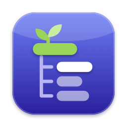

<p align="center"></p>

<p align="center">
  <a href="https://github.com/oxforge/drevo/actions/workflows/ci.yml"></a>
  <a href="https://github.com/oxforge/drevo/releases/latest"></a>
  <a href="LICENSE"></a>
  <a href="#requirements"></a>
</p>

# Drevo

A native dual-pane file manager for macOS, built to replace Finder for everyday use.
Miller columns like Finder's Column view, two (up to four) panes like Midnight Commander,
Finder's shortcuts plus the commander keys (Tab, F5 copy, F6 move, …), a built-in command
line that runs in the current folder, and a Settings window for the rest.

- **Two panes, two views.** Each pane shows Columns (Miller columns with a file preview)
  or List (Name/Date/Size/Kind). ⌘3 / ⌘2 switch the active pane. Each pane sorts by name,
  kind, date modified, date created or size (header button, View ▸ Sort By, or ⌃⌥⌘ +
  number), and remembers it. In Columns, drag a column's edge to resize it (⌥-drag
  resizes them all and keeps the width). Double-click the divider between panes, or
  Panes ▸ Make Panes Equal Width, to even them out.
- **Tabs in each pane.** ⌘T opens another tab on the same folder, ⌃⇥ / ⌃⇧⇥ switch, ⌘W
  closes the tab (the window, when it's the pane's last one; ⇧⌘W always closes the
  window). Each tab keeps its folder, view, sort order and history, and tabs come back
  at the next launch.
- **Filter and search.** Start typing (or ⌘F) to filter the folder by name; `*` and `?`
  are wildcards. ⌥⌘F searches the folder and everything inside it: type a name, press
  Return, and the matches are listed with their locations. Every file command works on
  the results, ⌘↑ shows a result in its own folder, Esc goes back.
- **Copy between panes in one key.** F5 copies and F6 moves the selection to the other
  pane, or ⇧⌘C / ⇧⌘M on a laptop keyboard. Drag & drop works between panes and with other
  apps, using Finder's rules: the same volume moves, another volume copies, ⌥ forces a
  copy, ⌘ forces a move. Dropping on a folder of the path bar puts the files there.
- **Archives expand in place.** Opening a .zip or .tar(.gz/.bz2/.xz) expands it next to
  itself the way Finder does (one item lands beside the archive, several go into a folder
  named after it), without Archive Utility popping up a Finder window. Select several and
  press Return or double-click to expand them all; ⌘Z removes the result.
- **Safe file operations.** Copies, moves, duplicates, permanent deletes, and undo and
  redo run in the background with a progress bar and Stop. Name clashes ask Replace / Keep Both / Skip / Stop, and Replace moves the old
  item to the Trash. ⌘Z undoes copy, move, rename, trash, new folder and duplicate.
- **Shell built in.** ⌥⌘T opens your terminal app in the current folder. Press `!` to type
  a command into the command line under the panes. It runs in the active pane's folder
  with your login shell and streams its output into a console.
- **Learnable.** A key-hint bar at the bottom shows the main keys. ⇧⌘P opens a command
  palette that searches every command and shows its shortcut, and Help ▸ Keyboard
  Shortcuts lists them all.
- **Configurable.** Hidden files (⇧⌘.), Return opens or renames, row size, which bars
  show, terminal and editor apps, and every shortcut (Settings ▸ Keys, or
  `keybindings.json`). Settings ▸ General can record a global shortcut that brings Drevo
  to the front from any app.

## Requirements

- macOS 14 Sonoma or later (developed on macOS 26).
- Xcode **Command Line Tools** (`xcode-select --install`). Full Xcode isn't needed.

## Build and run

```bash
make app
```

```bash
make run
```

| Command | What it does |
| --- | --- |
| `make app` | Release build, assembles and signs `build/Drevo.app` (ad hoc, or with the local identity once it exists) |
| `make signing-identity` | One-time: creates the "Drevo Local Signing" identity so rebuilds keep their privacy permissions |
| `make run` | `make app`, then opens it |
| `make test` | Unit and UI-controller tests (swift-testing) |
| `make snapshot` | Renders the window to `build/snapshots/{light,dark}.png` (add `SNAP_ARGS="--open ~/some/folder"`) |
| `make dmg` | `make app`, then puts it in `build/Drevo-<version>.dmg` with an Applications shortcut (`VERSION=0.3.1` sets the version; the default is the current release) |
| `make ci-signing-secret` | One-time: stores the "Drevo Local Signing" identity as GitHub secrets, so releases are signed with it too |
| `make clean` | Removes `.build` and `build` |

The Makefile works around two Command-Line-Tools quirks: it passes `--build-system native`
(the default swift-build backend fails without Xcode), and it adds the CLT's
`Testing.framework` path so `swift test` can find swift-testing (only where that folder
exists; with Xcode, as on the CI runners, swift-testing is found without it).

## Install

Download the DMG from the repository's Releases page, open it, and drag Drevo to
Applications. Or build it yourself:

```bash
cp -R build/Drevo.app /Applications/
```

Use `~/Applications` if you prefer. Install before switching on any of the Finder
integration below, so macOS registers the copy that stays put.

**First launch of a downloaded release.** The release is signed with a self-signed
certificate, not an Apple Developer ID, so macOS refuses to open it the first time ("Apple
could not verify…"). Click Done, then System Settings ▸ Privacy & Security ▸ **Open
Anyway**. macOS remembers the choice. Releases run on Apple Silicon Macs only.

**Updates.** Drevo ▸ **Check for Updates…** asks GitHub for the latest release. Drevo
checks only when you choose the command. A newer version is shown with its release notes;
**Install and Relaunch** downloads its disk image, checks that the app in it is signed
with the same certificate as the one running, replaces the app and opens the new one.
A copy built with `make app` and no signing identity is signed ad hoc and has no
certificate to compare with, so there Drevo offers the release page instead.

**Privacy prompts.** macOS asks once per protected folder (Desktop, Documents, Downloads,
removable volumes). For a file manager it's simpler to grant **Full Disk Access** in System
Settings ▸ Privacy & Security ▸ Full Disk Access. `make app` signs ad hoc, so macOS can
ask again after a rebuild. To keep the grants, sign with a stable identity. Either run
`make signing-identity` once: it creates a self-signed certificate, "Drevo Local
Signing", in your login keychain, and `make app` signs with it from then on (macOS asks
for your login password so codesign may use the key; choose Always Allow). Or pass your own:
`make app SIGN_ID="Apple Development: Your Name (TEAMID)"`. Releases are signed with the
same "Drevo Local Signing" certificate (see below), so a downloaded release and your own
build count as the same app and keep the grants.

## CI and releases

GitHub Actions runs two workflows, on GitHub's `xcode-27` runner (Apple Silicon, the
Xcode 27 toolchain):

- **CI** (`.github/workflows/ci.yml`): every push to any branch and every pull request
  runs `make test`, then `make app`. A newer push to the same branch cancels the run
  still going.
- **Release** (`.github/workflows/release.yml`): pushing a version tag tests and builds
  that version, signs it, and publishes a GitHub release with `Drevo-<version>.dmg`
  attached. Its notes are `docs/release-notes/<version>.md`, or generated from the
  commits when that file is missing. The tag sets the app's version; a tag with a suffix
  (`v0.3.0-beta1`) makes a pre-release. If the build fails, no release is made. Before
  tagging, set `VERSION` in the Makefile (the version of local builds) and write the
  notes.

```bash
git tag v0.3.1 && git push origin v0.3.1
```

**Signing releases, once.** With the GitHub CLI logged in (`gh auth login`) and the repo
pushed, run:

```bash
make ci-signing-secret
```

It creates the "Drevo Local Signing" identity if you don't have it yet, exports it with
a random password and stores both as the repository secrets `SIGNING_CERT_P12` and
`SIGNING_CERT_PASSWORD` (macOS asks for your login password so the export may read the
private key). Without these secrets, releases are signed ad hoc, which works but makes
macOS forget the app's privacy grants after every update; the Release run then shows a
warning.

## Using Drevo instead of Finder

macOS doesn't let another app fully take Finder's place. On macOS 26, Launch Services
**refuses to make any app but Finder the default for folders**. Both
`NSWorkspace.setDefaultApplication(... .folder)` and the older
`LSSetDefaultRoleHandlerForContentType("public.folder", …)` return paramErr (-50). The
Settings button still asks, in case a macOS version allows it, and explains when it
doesn't.

What does work, under **Settings ▸ Finder** and from Finder itself:

| Way in | How |
| --- | --- |
| Finder's right-click menu | Services ▸ **Open in Drevo**. Give it a shortcut in System Settings ▸ Keyboard ▸ Keyboard Shortcuts ▸ Services |
| Finder's toolbar | ⌘-drag Drevo.app from Applications into the toolbar, then drop folders on it |
| Dock | Drop folders on Drevo's icon |
| Terminal | `open -a Drevo .` |
| "Show in Finder" in other apps | Settings ▸ Finder ▸ *Use Drevo for "Show in Finder"* sets the system `NSFileViewer` default; apps pick it up after a restart, and some always use Finder |
| Login | Settings ▸ Finder ▸ *Open Drevo at login* |

Finder keeps running, because it draws the Desktop and owns the Trash.

## Keyboard

Drevo keeps Finder's shortcuts and adds the commander ones. Nothing uses a macOS
system-wide shortcut; a unit test checks the defaults against that list.

| Action | Keys |
| --- | --- |
| Move / extend selection, jump by typing | ↑ ↓, ⇧↑ ⇧↓, type a name |
| Page down / up, first / last item (⇧ extends the selection) | fn↓ / fn↑, fn← / fn→ (Page Down/Up, Home/End) |
| Up a level / into folder (both views) | ← / → |
| Open (enter folder, open files, expand archives; works on the whole selection) | Return, ⌘↓, double-click |
| Enclosing folder, Back, Forward | ⌘↑, ⌘[, ⌘] |
| Switch pane | Tab / ⇧Tab |
| Copy / Move to other pane | F5 / F6, or ⇧⌘C / ⇧⌘M |
| Rename | F2, ⌘R (or Return, if Settings says Return renames) |
| New folder / new file | F7 or ⇧⌘N / ⌥⌘N |
| Move to Trash / delete immediately | F8 or ⌘⌫ / ⌥⌘⌫ (asks first) |
| Quick Look | Space, F3, ⌘Y |
| Edit in your editor | F4 |
| Copy, Cut, Paste, Move here | ⌘C, ⌘X, ⌘V, ⌥⌘V |
| Duplicate, Make alias, Copy path, Get Info | ⌘D, ⌃⌘A, ⌥⌘C, ⌘I |
| Undo / Redo | ⌘Z / ⇧⌘Z |
| Go to folder (Tab completes) | ⌘L, ⇧⌘G, type `/` or `~`, or click the path bar's blank space / current folder (full path, selected) |
| Filter this folder: names containing the text, or a `*`/`?` pattern for the whole name (`*.png`); ⌫ deletes, Esc clears, leaving the folder clears it | just type, or ⌘F |
| Show hidden files | ⇧⌘. |
| List / Columns | ⌘2 / ⌘3 |
| Sort by Name / Kind / Date Modified / Size (again reverses) | ⌃⌥⌘1 / ⌃⌥⌘2 / ⌃⌥⌘5 / ⌃⌥⌘6, or the sort button in the pane header |
| Open in other pane, Swap panes | ⌥⌘O, ⌘U |
| Home, Desktop, Documents, Downloads, Applications, Utilities | ⇧⌘H, ⇧⌘D, ⇧⌘O, ⌥⌘L, ⇧⌘A, ⇧⌘U |
| Open in Terminal | ⌥⌘T |
| Run shell command / Stop it / Console | `!` or ⌥⌘R / ⌘. / ⌥⌘J |
| Command palette | ⇧⌘P |

On a MacBook, F-keys need Fn unless "Use F1, F2, etc. keys as standard function keys" is
on. Every frequent F-key action also has a key that needs no Fn.

### Remapping keys

**Settings ▸ Keys** lists every command with its keys. Click a key and press the new
one, click **+** to add another, hover over a key and click **×** to remove it; **↺**
resets one command and **Reset All…** every one. Search finds commands by name or by key
("rename", "f5", "⌘D"), and **Changed** shows only the ones you changed. A key another
command has is moved only after you confirm, macOS system shortcuts are refused, and
changes apply at once. A plain key (a letter, Tab, an arrow) works in the file list only,
and a letter bound there no longer starts the filter. Every ⌘, ⌃ or F-key you add works
wherever the command's first key does, text fields included.

The editor saves to `~/Library/Application Support/drevo/keybindings.json`, which you can
also edit by hand: Help ▸ **Edit keybindings.json** creates it and a
`keybindings.defaults.json` reference beside it. The editor writes only the commands that
differ from their defaults and keeps every other entry's value as you wrote it (it
re-indents the file and sorts the entries). Map command ids to keys:

```json
{
  "file.rename": ["f2", "return"],
  "nav.levelUp": ["left", "h"],
  "nav.levelDown": ["right", "l"],
  "pane.swap": null
}
```

Keys are written like `cmd+shift+n`, `opt+cmd+backspace`, `f5`, `tab` or `!`. A value is
one key or a list of keys; `null` or `[]` unbinds a command. Hand edits apply when you
switch back to Drevo, and unknown commands, bad keys or clashes are reported. A key that
can't be read is skipped, and if none of a command's keys can be read (a typo), the
command keeps the keys it had. While the file isn't valid JSON, Settings ▸ Keys won't
change it. Switching General ▸ Return key moves Return between Open and Rename, even
after you changed their other keys.

## The command line

The bar under the panes runs commands in the active pane's folder:

- **Return** runs the command with your login shell, the one set in your user account
  (the same one Terminal uses). Drevo loads your shell config once (`shell -l -i`) and
  reuses its PATH, environment, aliases and functions, so each command starts in
  milliseconds instead of re-running `~/.zshrc`. It reloads when a startup file changes,
  after an hour, or via Settings ▸ Shell ▸ Reload (zsh and bash; other shells load their
  config for every command). PATH, aliases and functions match Terminal.
  Output streams into the console (⌥⌘J), with stderr in red, then the exit status and
  timing. Colours and styles a command prints are shown: the 16 named colours (tuned
  for the light and the dark appearance), 256 and true colours, bold, dim, italic,
  underline and inverse. A command writes to a pipe here, not to a terminal, so many
  tools print colour only when asked to (`git -c color.ui=always log`,
  `ls --color=always`, `CLICOLOR_FORCE=1 ls`).
  The console keeps the latest 400,000 characters, and output that arrives
  faster than it can be shown is skipped, with an "… output skipped …" note.
  ⌘. stops the command: Ctrl-C to its whole process group, then a hard kill if it is
  still running two seconds later. Closing the window or quitting Drevo stops it too.
  A command is finished when its shell exits, even if it left a process in the
  background (`server &`): the console doesn't wait for that process and doesn't show
  what it prints later, so send its output to a file.
- **⌘Return** runs it in your terminal app instead, for interactive tools like vim, top
  or ssh, and leaves a shell open there.
- **⌥Return** inserts the selected names, shell-quoted (⇧⌥Return inserts full paths).
- **Tab** completes the file or folder name before the cursor, from the active pane's
  folder (or the path typed so far, `~/` included). Several matches extend to their
  common part; when nothing more can be added, a menu lists them. Spaces and other shell
  characters in a name are escaped. It completes file names, not command names.
- **↑ / ↓** walk the history. **Esc** returns to the pane.

Commands get stdin from `/dev/null` and `TERM=dumb`. Not reused from your config:
`setopt` options and unexported variables. To skip `~/.zshrc` entirely, turn off "Use my
shell config" in Settings ▸ Shell.

## Project layout

```
Sources/DrevoCore   Foundation-only model: listing, sorting, history, names, keymap and
                    command registry, file operations + copy engine + undo records,
                    FSEvents watcher, shell runner. Fully unit-tested.
Sources/DrevoUI     AppKit app: window, panes, List and Column browsers, sidebar, path bar,
                    operations UI, shell UI, palette, settings (SwiftUI).
Sources/drevo       Executable entry point.
Tests/              DrevoCoreTests (engine) and DrevoUITests (real windows driven with
                    synthetic key events, fake drags, scripted prompts).
scripts/            make-icon.swift draws the app icon; make-signing-identity.sh,
                    ci-signing-secret.sh and export-identity.swift set up signing.
Resources/          Info.plist template.
docs/               icon.png for this README (from make-icon.swift).
.github/workflows/  CI (test + build on every push) and Release (DMG on a version tag).
```

Deferred work is tracked in [TODO.md](TODO.md).
